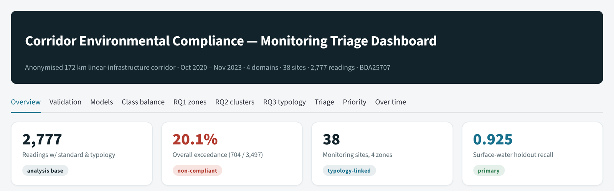
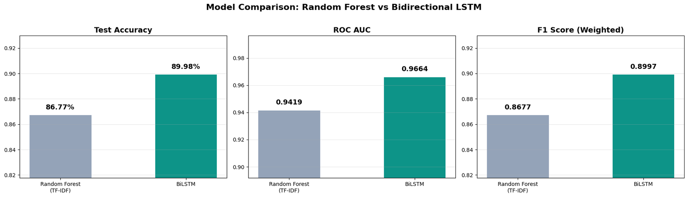

# Simanta Karmaker

**Data analyst with a background in construction HSE, applying machine learning to environmental, safety and health data.**

London, UK · MSc Business & Data Analytics (Distinction), Ravensbourne University London

---

## About me

Before moving into data science I was **Assistant Director, HSE&Q at China Railway Group Limited (CREC)** on a major infrastructure construction project (2022–2025). I ran site inspections and audits, reported incidents and prepared HSE reports for senior management, and saw first-hand how environmental monitoring and safety decisions are made in practice.

That experience shaped my MSc dissertation, which asks whether a breach of an environmental standard can be predicted before the sample is taken, so that monitoring goes where it is needed most. I am now developing it into a conference paper. Across my work I try to make results that hold up: I audit for data leakage, compare every model with simple baselines, validate in time order and explain what drives each prediction.

I currently work as a Fulfillment and Data Associate at 01Health in London, and I am looking for a **funded PhD** in environmental data science, construction and HSE safety analytics, health data science, or business analytics and operational research.

## Featured projects

### [Corridor Environmental Compliance](https://github.com/simanta-karmaker/corridor-environmental-compliance) · MSc dissertation

Predicts whether an air, water or noise reading will breach its national standard **before the sample is taken**, using 2,777 readings from 38 sites over three years on an anonymised infrastructure corridor.

- Found a target-leakage bug that had inflated earlier results, and rebuilt the features from past readings only
- Nested time-series cross-validation: the model beats a parameter-only baseline in every domain (noise F1 0.549 against 0.255)
- Showed that monitoring effort and risk are misaligned: in every zone, 39–56% of readings go to low-risk parameters
- Ten-tab Streamlit dashboard for prioritising monitoring by parameter and site

`Python` `scikit-learn` `XGBoost` `SHAP` `imbalanced-learn` `Streamlit` `Plotly`

### [Amazon Review Sentiment](https://github.com/simanta-karmaker/amazon-review-sentiment) · MSc AI & Machine Learning module

A Bidirectional LSTM that classifies product reviews as positive or negative, tested against a TF-IDF + Random Forest baseline on **the same 10,000 held-out reviews**.

- 90.0% accuracy (ROC AUC 0.966) against 86.8% (ROC AUC 0.942) for the baseline
- Error analysis shows the whole gain comes from positive reviews, and that negation is still a weak spot
- Found and fixed a train/test mismatch that had left the original coursework baseline at chance level

`Python` `TensorFlow / Keras` `scikit-learn` `NLP`

## Research interests

Models that help decide where limited inspection, monitoring or healthcare resources should go:

- **Environmental data science**: predicting compliance risk and prioritising environmental monitoring
- **Construction and HSE safety analytics**: learning from inspection and incident records
- **Health data science**: turning routinely collected data into decisions
- **Business analytics and operational research**: decision support when resources are limited

## Toolkit

| Area | Tools |
|---|---|
| Programming and data | Python (pandas, NumPy, SciPy), SQL |
| Machine learning | scikit-learn, XGBoost, TensorFlow / Keras, imbalanced-learn, SHAP |
| Visualisation and BI | Power BI, Tableau, Excel, Streamlit, Plotly, Matplotlib, seaborn |
| Methods | Time-series cross-validation, leakage auditing, class imbalance, clustering, NLP, CRISP-DM |
| Workflow | Git and GitHub, Jupyter, Google Colab |

## Experience and education

- **Fulfillment and Data Associate**, 01Health, London · 2026–present
- **Assistant Director, HSE&Q**, China Railway Group Limited (CREC) · 2022–2025  
  Site inspections and audits, incident reporting, HSE reporting to senior management, team supervision and payroll for 100–500 staff
- **MSc Business & Data Analytics**, Distinction · Ravensbourne University London · 2026
- **BBA in Finance** · University of Information Technology & Sciences
- **Certifications**: IOSH Managing Safely · OSHA 30-Hour General Industry Safety
